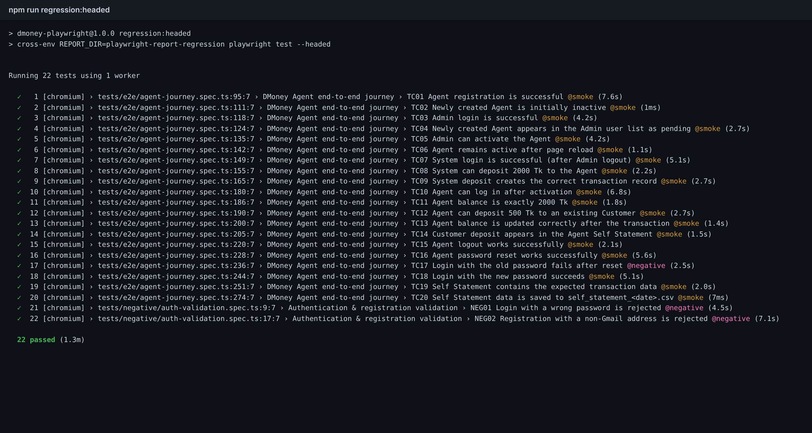
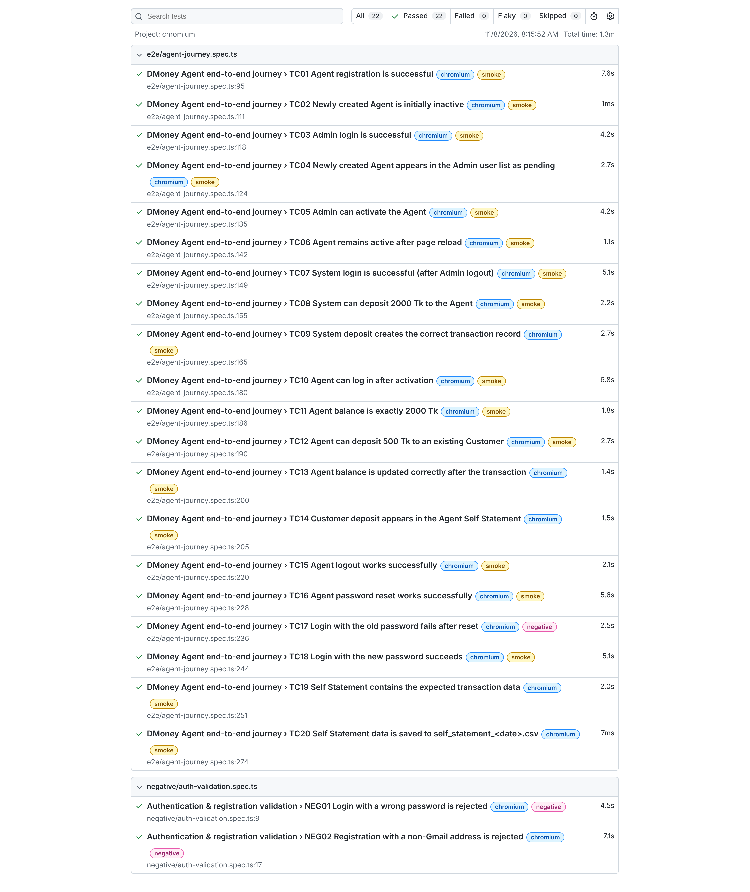
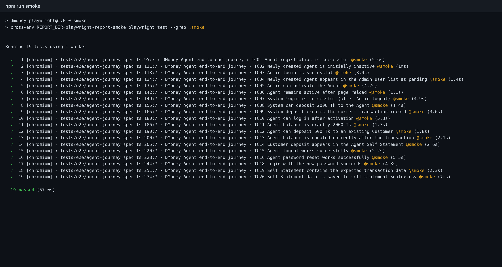
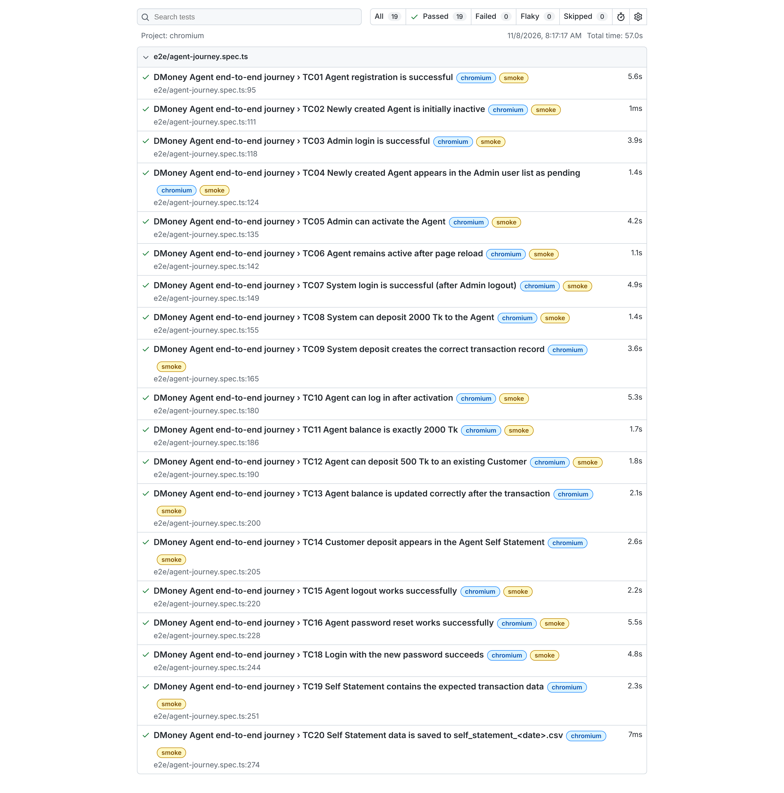
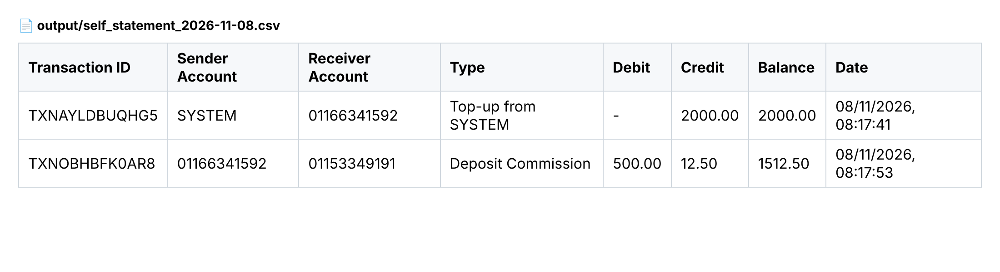

# DMoney Portal – Playwright E2E Automation

End-to-end automation of the **DMoney Agent journey** on
[`https://dmoneyportal.roadtocareer.net`](https://dmoneyportal.roadtocareer.net), built with
**Playwright + TypeScript**. It includes a Claude Code AI harness in [`.claude/`](.claude).

> Batch 1 · Topic: Playwright

**Student:** Nuruddin Kawsar · **Student ID:** NK44179

---

## Table of contents
1. [What the automation does](#what-the-automation-does)
2. [Test coverage](#test-coverage)
3. [Project structure](#project-structure)
4. [Setup & run](#setup--run)
5. [Regression Test Result](#regression-test-result)
6. [SmokeTest Result](#smoketest-result)
7. [Generated CSV output](#generated-csv-output)
8. [Video – headed run](#video--headed-run)
9. [AI harness (`.claude/`)](#ai-harness-claude)
10. [Design notes & portal quirks](#design-notes--portal-quirks)

---

## What the automation does

| # | Step | Where |
|---|------|-------|
| 1–3 | Open the portal, go to **Sign Up**, register a new **Agent** | TC01–TC02 |
| 4–6 | Log in as **Admin**, find the Agent, **activate** it, log out | TC03–TC06 |
| 7–9 | Log in as **System**, **deposit 2000 Tk** to the Agent, log out | TC07–TC09 |
| 10–11 | Log in as the **Agent** (with OTP), verify balance **2000 Tk** | TC10–TC11 |
| 12–13 | **Cash-in 500 Tk** to a Customer, verify success | TC12–TC14 |
| 14 | Log out | TC15 |
| 15–17 | **Reset the password**, verify that the **old password fails** and the **new one works** | TC16–TC18 |
| 18–20 | Open **Self Statement**, extract **all** rows, save `output/self_statement_YYYY-MM-DD.csv` | TC19–TC20 |

## Test coverage

| Required validation | Test | Suite |
|---|---|---|
| 1. Agent registration is successful | TC01 | smoke + regression |
| 2. New Agent is initially inactive (`pending`) | TC02 (+ `PENDING` chip in TC04/TC05) | smoke + regression |
| 3. Admin login is successful | TC03 | smoke + regression |
| 4. New Agent appears in the Admin user list | TC04 | smoke + regression |
| 5. Admin can activate the Agent | TC05 | smoke + regression |
| 6. Agent stays active after page reload | TC06 | smoke + regression |
| 7. System login is successful | TC07 | smoke + regression |
| 8. System can deposit 2000 Tk to the Agent | TC08 | smoke + regression |
| 9. System deposit creates the correct transaction record | TC09 | smoke + regression |
| 10. Agent can log in after activation | TC10 | smoke + regression |
| 11. Agent balance is exactly 2000 Tk | TC11 | smoke + regression |
| 12. Agent can deposit 500 Tk to an existing Customer | TC12 | smoke + regression |
| 13. Agent balance is updated correctly (**1512.50**, see notes) | TC13 | smoke + regression |
| 14. Customer deposit appears in the Agent's Self Statement | TC14 | smoke + regression |
| 15. Agent logout works | TC15 | smoke + regression |
| 16. Agent password reset works | TC16 | smoke + regression |
| 17. Login with the old password fails | TC17 | **regression only** (negative) |
| 18. Login with the new password succeeds | TC18 | smoke + regression |
| 19. Self Statement contains the expected transaction data | TC19 | smoke + regression |
| 20. Self Statement data is saved to the CSV file | TC20 | smoke + regression |
| Extra: wrong password is rejected | NEG01 | regression only |
| Extra: non-Gmail registration is rejected | NEG02 | regression only |
| Extra: Admin session is reused via storageState (no login step) | TC-AUTH01 | smoke + regression |
| Extra: System session is reused via storageState (no login step) | TC-AUTH02 | smoke + regression |

- **Regression suite:** all 24 tests (`npm run regression`).
- **Smoke suite:** the 21 positive tests tagged `@smoke` (`npm run smoke`).

## Project structure

```
.
├── .claude/                      # AI harness (see below)
│   ├── agents/                   # sub-agents: test writer, reviewer, debugger
│   ├── commands/                 # /run-regression, /run-smoke, /add-test
│   ├── hooks/typecheck.sh        # runs tsc after every TS edit made by Claude
│   ├── skills/dmoney-portal/     # portal knowledge: rules, selectors, quirks
│   └── settings.json             # permissions + hooks
├── CLAUDE.md                     # project memory / conventions for Claude Code
├── src/
│   ├── config/env.ts             # typed access to .env
│   ├── pages/                    # Page Objects (BasePage, Login, Register, AdminUsers, CashIn, SelfStatement, PasswordReset)
│   ├── types/                    # shared types
│   └── utils/                    # api.ts (setup only), csv.ts, data.ts
├── tests/
│   ├── global-setup.ts           # logs in as Admin/System once, saves storageState for reuse
│   ├── e2e/agent-journey.spec.ts # TC01–TC20 (ordered, one browser session)
│   ├── e2e/auth-reuse.spec.ts    # proves the saved Admin/System sessions restore correctly
│   └── negative/auth-validation.spec.ts
├── output/                       # self_statement_YYYY-MM-DD.csv
├── docs/                         # screenshots + video used in this README
├── playwright.config.ts
├── .env.example                  # copy to .env
└── .gitignore                    # node_modules, .env, reports, test-results, raw videos
```

## Setup & run

Prerequisites: Node.js 18+ (tested with Node 22).

```bash
npm install
```

```bash
npx playwright install chromium
```

```bash
cp .env.example .env
```

| Command | What it runs |
|---|---|
| `npm run regression` | full suite, HTML report in `playwright-report-regression/` |
| `npm run regression:headed` | same, with a visible browser |
| `npm run smoke` | positive tests only (`--grep @smoke`), report in `playwright-report-smoke/` |
| `npm run smoke:headed` | same, with a visible browser |
| `npm run typecheck` | TypeScript check |

To slow the browser down for a recording, set `SLOW_MO=400` in `.env`. Each run saves a single continuous
recording of the journey to `videos/agent-journey.webm`.

> ⚠️ The portal is a **shared live environment**. Every run creates a new Agent and a new Customer.

## Regression Test Result

`npm run regression`: **24 passed**, 0 failed (20 journey + 2 negative + 2 auth-state-reuse)





> Screenshots above are from the original 22-test run; the latest run (24 tests, including the new
> auth-state-reuse checks) also passed in full — see the terminal output in the project history.

## SmokeTest Result

`npm run smoke`: **21 passed** (positive tests only), 0 failed





## Generated CSV output

File: [`output/self_statement_2026-11-08.csv`](output/self_statement_2026-11-08.csv)



## Video – headed run

Full automation recorded in headed mode (regression suite, `SLOW_MO=400`):

**▶ [docs/videos/regression-run-headed.mp4](docs/videos/regression-run-headed.mp4)**

<video src="docs/videos/regression-run-headed.mp4" controls width="800"></video>

## AI harness (`.claude/`)

| Piece | Purpose |
|---|---|
| [`CLAUDE.md`](CLAUDE.md) | Project memory: commands, layout and conventions (tags, locator style, no hard-coded secrets, shared-environment etiquette) |
| [`.claude/settings.json`](.claude/settings.json) | Pre-approves the safe project commands (test, smoke, typecheck, report), **denies reading `.env`** and blocks destructive commands, and registers the hook |
| [`.claude/hooks/typecheck.sh`](.claude/hooks/typecheck.sh) | `PostToolUse` hook: after Claude edits a `.ts` file it runs `tsc --noEmit` and sends any errors back to Claude |
| [`.claude/skills/dmoney-portal/SKILL.md`](.claude/skills/dmoney-portal/SKILL.md) | Domain knowledge collected while exploring the portal: roles, OTP, commission, balance caps, selectors, pagination quirk |
| [`.claude/agents/playwright-test-writer.md`](.claude/agents/playwright-test-writer.md) | Sub-agent that writes tests and Page Objects following the conventions |
| [`.claude/agents/playwright-test-reviewer.md`](.claude/agents/playwright-test-reviewer.md) | Read-only reviewer: checks coverage, flakiness, assertion strength and tags |
| [`.claude/agents/playwright-debugger.md`](.claude/agents/playwright-debugger.md) | Diagnoses failures from `error-context.md` and traces, and fixes selectors or timing without weakening assertions |
| [`.claude/commands/`](.claude/commands) | `/run-regression`, `/run-smoke`, `/add-test <scenario>` |

## Design notes & portal quirks

- **One session, ordered tests.** The journey is stateful (each step needs the previous one), so it runs
  as `test.describe.serial` with one shared browser context. This also produces one continuous video.
- **OTP and reset link.** Agent login needs a 4-digit OTP, and the password reset sends a link. Both go to the
  registered **Gmail** inbox, which an automated test cannot read. The admin endpoint `GET /user/search/id/:id`
  returns the user's current `otp` and `reset_token`, so the tests read them for **the user the test created
  only**. Everything else is done and asserted in the UI.
- **Agent commission.** The portal pays the Agent **2.5 %** on each cash-in. After 2000 in and 500 out the
  balance is **1512.50**, not 1500, and the statement shows a credit of 12.50. TC13, TC14 and TC19 assert the
  exact value.
- **Customer balance cap.** Customers have a balance limit (about 10,000 Tk). The seeded customers are often almost
  full ("Limit exceeded. You can deposit a maximum of 42.80 tk"). To keep the test reliable, `beforeAll` creates and
  activates a fresh Customer through the API. To use your own customer instead, set `CUSTOMER_PHONE`.
- **Self Statement pagination.** The paginator counts the account's *all-time* history, but the table only
  shows rows inside the date filter (today). For the System account the "next" button therefore never disables.
  The extractor stops at the first page with no matching rows, since the server returns the newest rows first.
- **CSV.** Columns are exactly the table headers. Values are RFC-4180 quoted (the date contains a comma). The
  file name uses the machine's local date (`self_statement_YYYY-MM-DD.csv`). TC20 reads the file back and
  compares it with the table.
